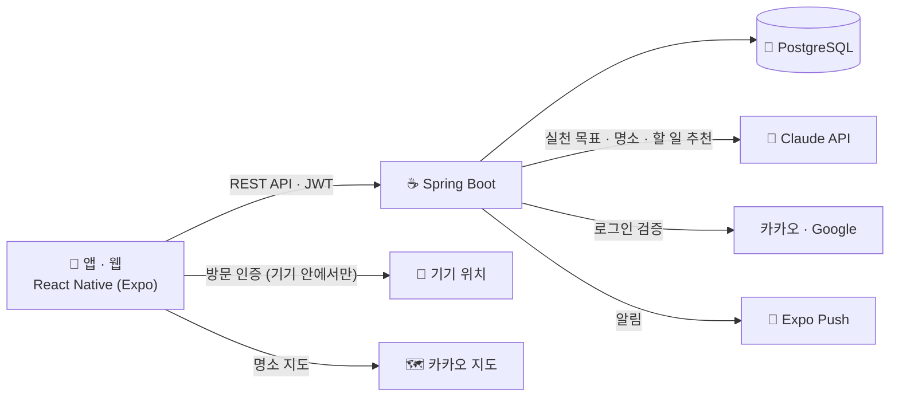

# 🪨 한 가지만

**소원 하나를 정하고, 30일 동안 매일 돌을 하나씩 쌓아 소원탑을 완성하는 서비스**

2026 단디톤 출품작 · 주제 **RESONANCE: 우리가 대구·경북을 좋아하는 진짜 이유**

[🌐 실서비스 웹](https://han-gajiman.github.io) · [🎮 데모 웹 (체험용)](https://han-gajiman.expo.app)

---

## 어떤 서비스인가요?

소원은 많을수록 흐려집니다. **한 가지만**은 이루고 싶은 소원을 딱 하나만 정하고, 30일 동안 매일 작은 실천을 할 때마다 돌을 하나씩 쌓게 합니다.

대구·경북에는 소원이 깃든 명소가 많습니다. "한 가지 소원은 꼭 들어준다"는 팔공산 갓바위, 선비들이 합격을 빌며 넘던 문경새재 과거길, 해가 가장 먼저 뜨는 호미곶 같은 곳이에요. 매일 쌓은 돌탑은 고른 명소의 풍경 위에 서고, 실제로 그곳을 방문하면 가려져 있던 풍경 일러스트와 엽서가 열립니다. 돌을 쌓으며 소원을 빌던 오래된 마음을 오늘의 작은 습관과 경북 여행으로 다시 잇는 것이 저희가 생각한 **RESONANCE**입니다.

## 주요 기능

| | 기능 | 설명 |
|---|---|---|
| 🌠 | **소원 하나 정하기** | 소원과 매일 할 실천 목표를 적고, 경북 명소 10곳 중 하나를 골라 다짐합니다. 한번 정한 소원은 고칠 수 없어요. |
| 🤖 | **AI 추천** | 소원을 적으면 AI가 실천 목표 3개와 어울리는 명소를 추천합니다. 소원 캘린더에서는 그날 할 일을 하나씩 추천받아요. |
| 🪨 | **오늘의 돌 쌓기** | 하루에 돌 하나만 쌓을 수 있어요. "오늘 하루는 어땠나요?"에 기록을 남기거나, 캘린더에 적어 둔 할 일을 골라 쌓습니다. |
| 🗺️ | **명소 방문 인증** | 명소 반경 안에 가면 방문을 인증할 수 있고, 돌탑 배경이 그 명소의 풍경 일러스트로 바뀝니다. 위치는 기기 안에서만 확인하고 서버로 보내지 않아요. |
| 💌 | **디지털 엽서와 우체통** | 방문할 때마다 그 명소의 엽서 4종 중 하나를 받습니다. 엽서 뒷면에 글을 써서 친구나 나에게 보내고, 앞뒷면을 이미지로 저장할 수 있어요. |
| 📅 | **소원 캘린더** | 진행 중·지난 돌탑과 앞으로 할 소원을 기간 줄로 보고, 날짜마다 할 일을 적어 둡니다. |
| 🤝 | **친구와 함께** | 초대 링크로 친구를 맺고, 친구 돌탑을 보며 응원을 남기거나, 오늘 아직 안 쌓은 친구를 콕 찌를 수 있어요. |
| 🏔️ | **30일 회고와 모아보기** | 30일이 지나면 "이 소원, 이루었나요?" 회고를 남깁니다. 완성한 돌탑은 1년 단위로 모이고, 1년이 지나면 "나는 어떤 사람이 되었나요?" 1년 회고를 씁니다. |

## 둘러보기

- **데모 웹**: [han-gajiman.expo.app](https://han-gajiman.expo.app)은 브라우저 안의 예시 데이터로 동작해서 가입 없이 바로 체험할 수 있어요. 로그인 화면에서 **로그인**만 누르면 되고, 시연용 시간 이동 버튼으로 30일 완성이나 1년 회고 장면도 볼 수 있습니다.
- **실서비스 웹**: [han-gajiman.github.io](https://han-gajiman.github.io)는 실제 서버에 연결되어 있어요. 이메일, 카카오, Google로 가입해서 쓸 수 있습니다.

## 시스템 구성

| 영역 | 사용 기술 |
|---|---|
| 앱 · 웹 | React Native 0.88, Expo SDK 58, Expo Router, TypeScript, Reanimated, NativeWind |
| 서버 | Java 17, Spring Boot 3.3, Spring Data JPA, Spring Security + JWT, Flyway |
| 데이터베이스 | PostgreSQL 16 |
| AI | Claude API (Claude Haiku 5.5), 백엔드에서만 호출하고 1인 하루 10회로 제한 |
| 지도 · 로그인 | 카카오 지도, 카카오 로그인, Google 로그인 |
| 배포 | AWS EC2 + Docker Compose + Caddy(HTTPS), GitHub Pages(실서비스 웹), EAS Hosting(데모 웹) |

## 저장소

| 저장소 | 내용 |
|---|---|
| [frontend](https://github.com/han-gajiman/frontend) | 앱·웹 (Expo). 화면, 애니메이션, 목 서버(데모 웹용 예시 데이터) |
| [backend](https://github.com/han-gajiman/backend) | API 서버 (Spring Boot). 기능명세서·API 명세서·ERD는 `docs/`에 있어요 |
| [han-gajiman.github.io](https://github.com/han-gajiman/han-gajiman.github.io) | 실서비스 웹 배포본 (빌드 결과물) |

## 지킨 원칙

- **소원은 하나, 하루에 돌은 하나.** 소원과 실천 목표는 등록한 뒤 고칠 수 없고, 돌은 하루에 하나만 쌓을 수 있어요.
- **위치정보는 기기 밖으로 나가지 않습니다.** 방문 인증은 기기 안에서 명소 반경을 계산하고, 서버에는 "인증했다"는 결과만 보냅니다. 좌표나 거리는 저장하지 않아요.
- **AI는 백엔드에서만 부릅니다.** API 키는 앱에 들어가지 않고, 소원 내용은 저장하지 않으며 호출 시각만 남겨 횟수를 제한합니다.
